<div align="center">


# Turma dos Jogos

**Jogos educativos para crianças, com área do responsável, perfis e progresso salvo na nuvem.**

🌐 **[turmadosjogos.com.br](https://turmadosjogos.com.br)**


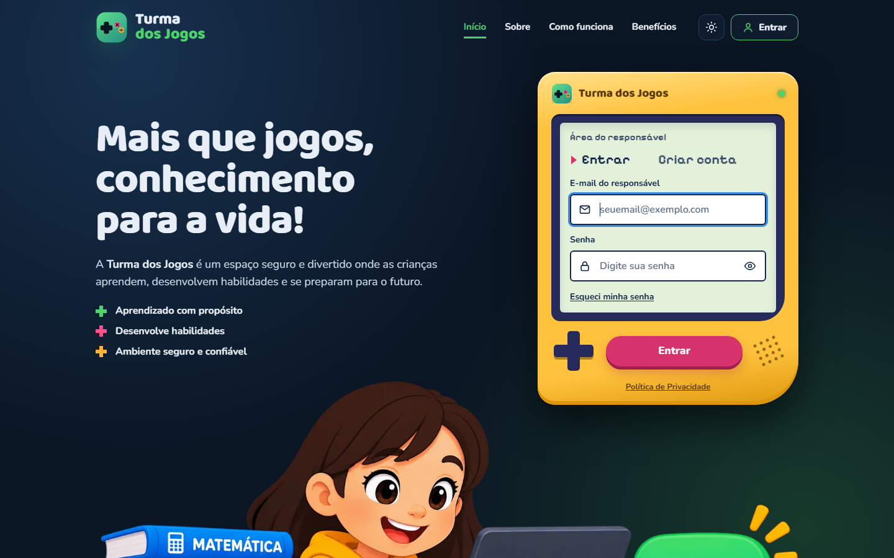

</div>

---

## Sumário

- [Sobre o projeto](#sobre-o-projeto)
- [Jogos](#jogos)
- [Telas](#telas)
- [Arquitetura na AWS](#arquitetura-na-aws)
- [O que cada serviço faz](#o-que-cada-serviço-faz)
- [API](#api)
- [Estrutura do repositório](#estrutura-do-repositório)
- [Como rodar localmente](#como-rodar-localmente)
- [Como publicar](#como-publicar)
- [Como adicionar um jogo novo](#como-adicionar-um-jogo-novo)
- [Segurança e privacidade](#segurança-e-privacidade)
- [Custos](#custos)
- [Links](#links)

---

## Sobre o projeto

A **Turma dos Jogos** é um espaço de jogos educativos para crianças aprenderem brincando. Cada jogo treina um conteúdo da escola (tabuada, vocabulário em inglês, memória) de um jeito divertido.

- **Sem anúncios.** A criança joga num perfil criado pelo responsável, só com um apelido.
- **Conta do responsável** com e-mail e senha (Amazon Cognito). Cada conta pode ter **até 6 perfis** de crianças.
- **Progresso salvo na nuvem** (com licença ativa): recordes, medalhas, níveis liberados e skins ficam no perfil e acompanham a criança em qualquer aparelho. Veja [Licença da conta](#licença-da-conta).
- **Funciona no computador e no celular**, com tema claro e escuro e instalação como app (PWA, via `manifest.webmanifest`).
- **Front-end sem framework e sem build:** HTML, CSS e JavaScript puros, publicados como arquivos estáticos.
- **Back-end 100% serverless** na região `sa-east-1` (São Paulo), descrito num único template do CloudFormation.

### Como funciona para o usuário

1. **Crie a conta do responsável** com e-mail e senha (8+ caracteres, com maiúscula, número e caractere especial). O código de confirmação chega por e-mail.
2. **Crie o perfil da criança:** apelido, cor e desenho (menino ou menina).
3. **Hora de jogar!** A criança escolhe o jogo, e cada recorde, medalha e nível conquistado fica salvo no perfil dela.

---

## Jogos

| | Jogo | Conteúdo | Como joga |
|---|---|---|---|
| 🐍 | **Cobra Tabuada** | Matemática: tabuada do 1 ao 10 | Guie a cobra até os orbes (setas, WASD ou deslizando o dedo). Cada orbe abre uma conta: acertou, ganha ponto; errou, fim de jogo. O tempo para responder diminui conforme os pontos sobem. Tem vestiário de skins e área de estudos. Gráficos em 3D com three.js. |
| ⚽ | **Gol de Inglês** | Inglês: vocabulário | Bata o pênalti clicando no gol e depois traduza a palavra. Tem 3 níveis (Fácil: cores; Médio: animais e frutas; Difícil: escola e casa), e 5 gols liberam o próximo. |
| 🃏 | **Memória em Inglês** | Inglês: palavras e pronúncia | Vire as cartas e junte cada palavra em inglês com a sua figura. Cada palavra virada é falada em voz alta, e menos jogadas rendem mais estrelas. Tem 3 níveis (6, 8 e 10 pares). |

---

## Telas

<table>
<tr>
<td width="50%">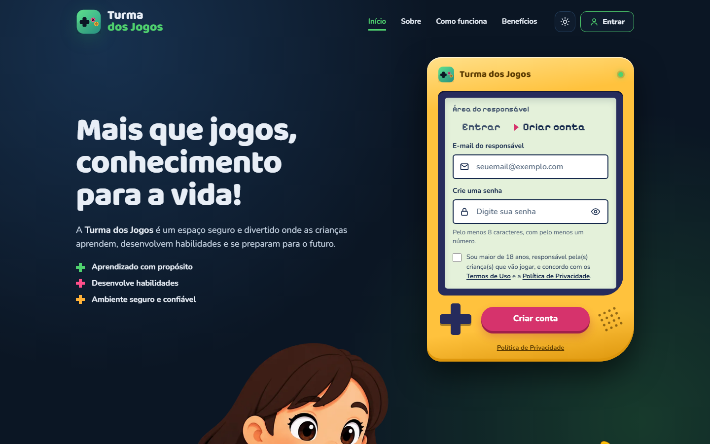<br><sub><b>Criar conta</b>: login do responsável no estilo de um videogame portátil</sub></td>
<td width="50%">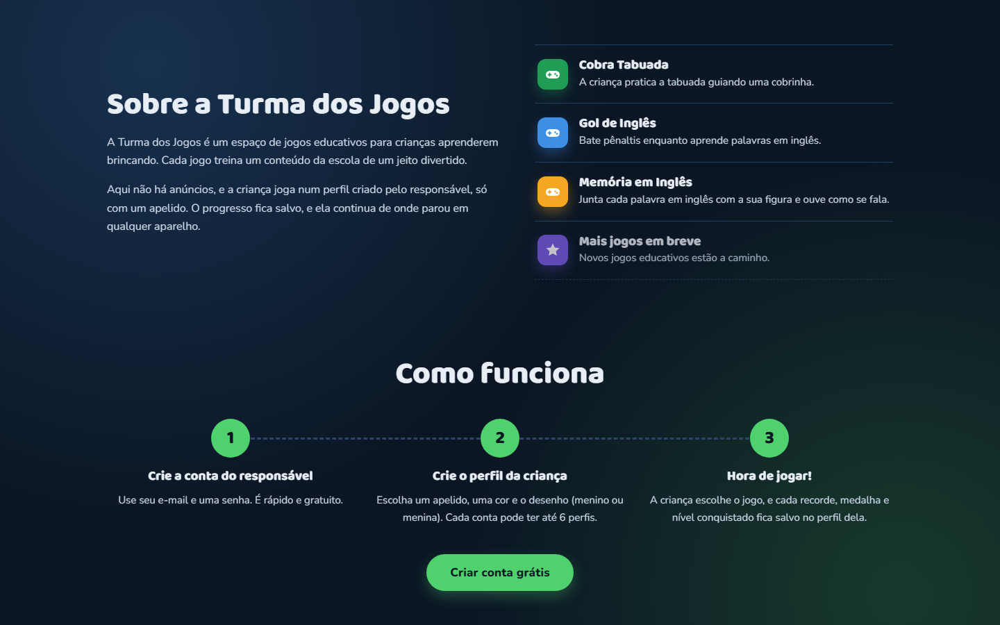<br><sub><b>Sobre e Como funciona</b>: lista de jogos e os 3 passos</sub></td>
</tr>
<tr>
<td>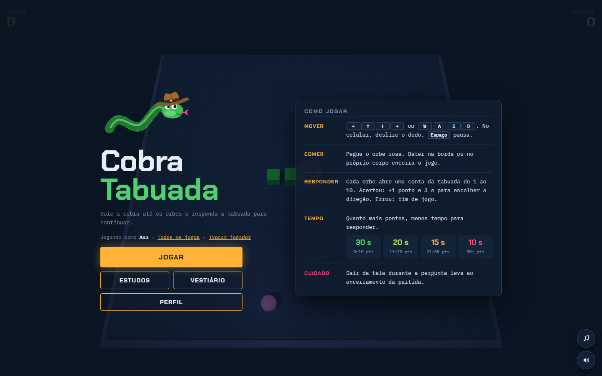<br><sub><b>Cobra Tabuada</b></sub></td>
<td>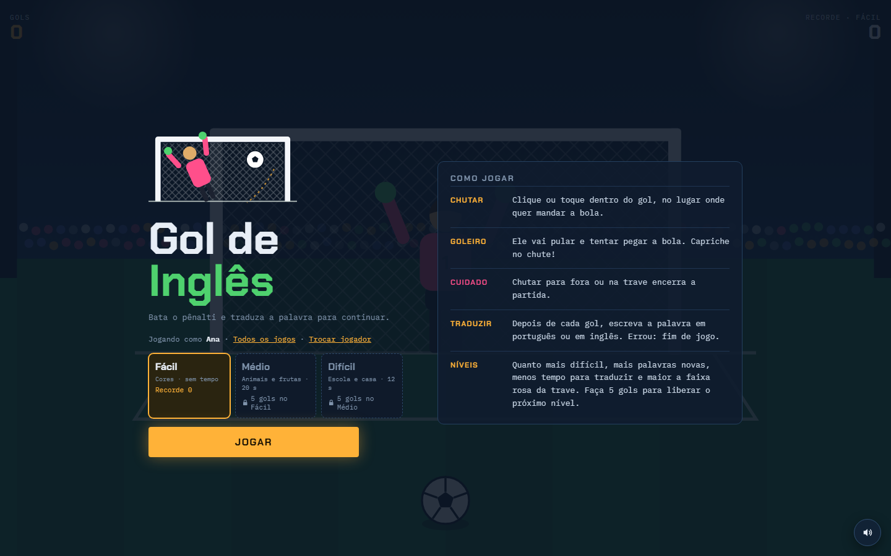<br><sub><b>Gol de Inglês</b></sub></td>
</tr>
<tr>
<td>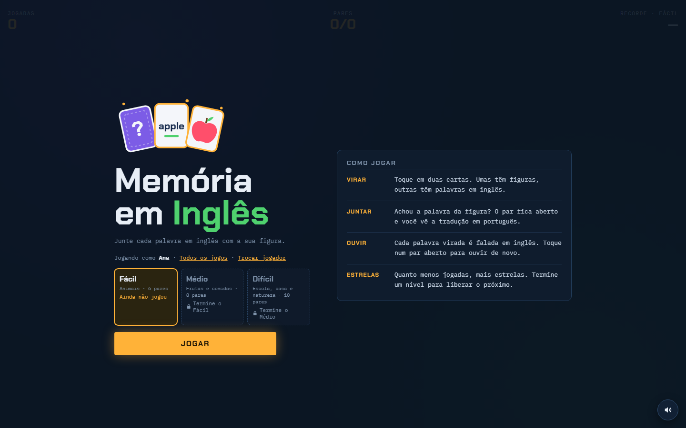<br><sub><b>Memória em Inglês</b></sub></td>
<td>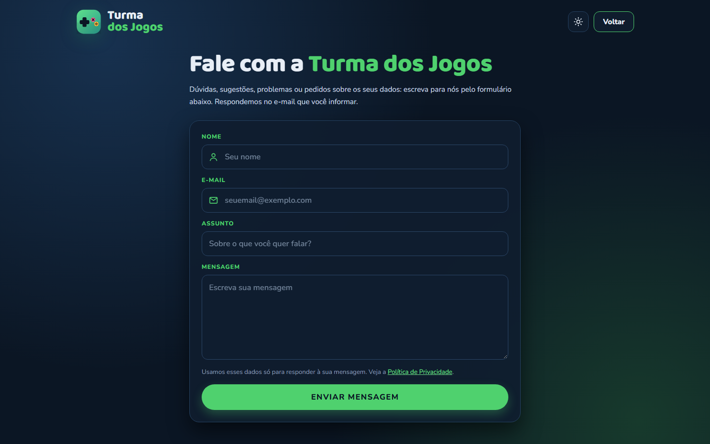<br><sub><b>Contato</b>: formulário com desafio anti-robô</sub></td>
</tr>
<tr>
<td>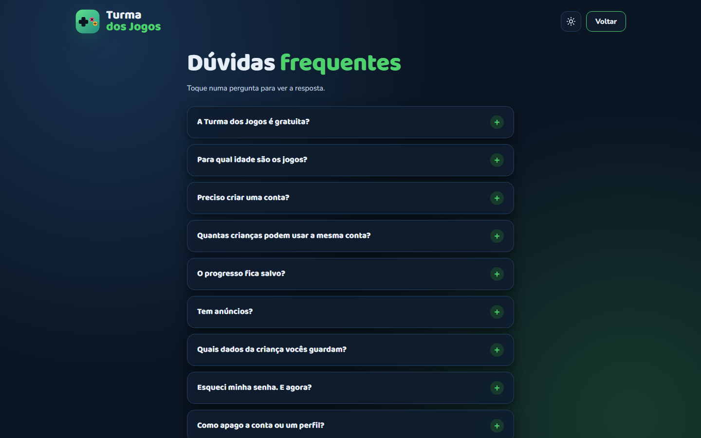<br><sub><b>Dúvidas frequentes</b></sub></td>
<td>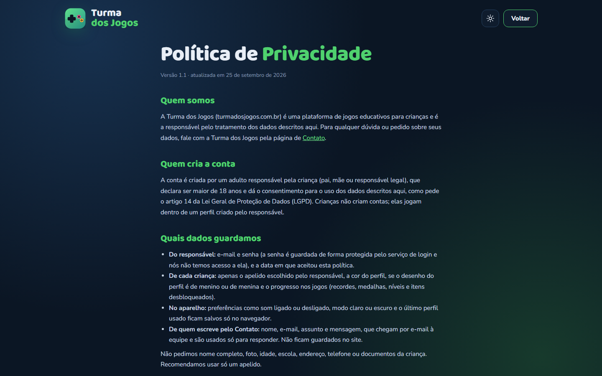<br><sub><b>Política de Privacidade</b></sub></td>
</tr>
</table>

<p align="center">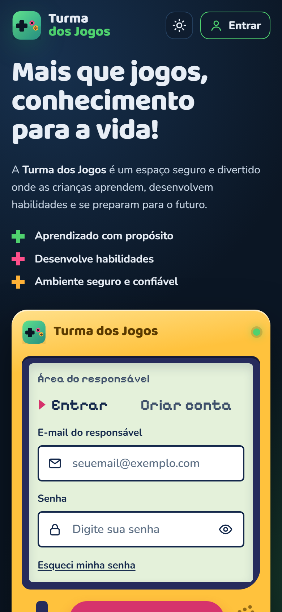<br><sub><b>Versão para celular</b></sub></p>

---

## Arquitetura na AWS

Tudo roda na região **sa-east-1 (São Paulo)** e é serverless, sem nenhum servidor ligado o tempo todo. O site é estático e o back-end responde sob demanda.

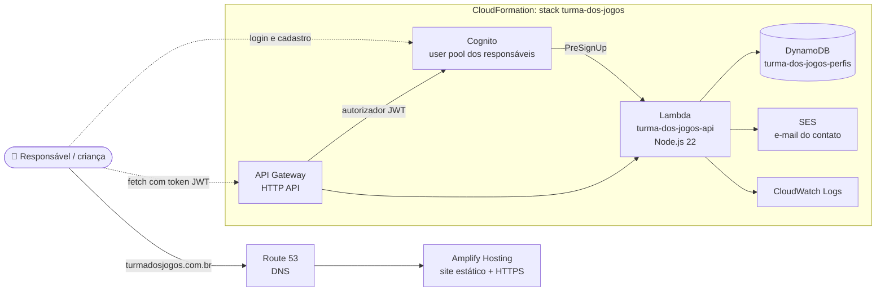

O site (Amplify) e o DNS da zona ficam fora do stack. Já os registros de e-mail no Route 53 (SPF, DKIM e DMARC) são criados pelo próprio stack.

---

## O que cada serviço faz

| Serviço | Recurso | Função |
|---|---|---|
| **AWS Amplify Hosting** | app `turma-dos-jogos`, branch `producao` | Hospeda o site estático (pasta `site/`) com HTTPS e domínio próprio (`turmadosjogos.com.br` e `www`). |
| **Amazon Route 53** | zona `turmadosjogos.com.br` | Aponta o domínio para o Amplify e publica os registros que autenticam os e-mails: SPF, 3 DKIM e DMARC (`p=quarantine`). O domínio é registrado fora da AWS. |
| **Amazon Cognito** | user pool `turma-dos-jogos-responsaveis` | Cadastro e login dos responsáveis por e-mail e senha, verificação em duas etapas opcional (app autenticador), verificação do e-mail e recuperação de senha. Emite o token JWT usado na API. O gatilho **PreSignUp** chama a Lambda para validar o cadastro e registrar o aceite da Política de Privacidade. |
| **Amazon API Gateway** (HTTP API) | `turma-dos-jogos` | Porta de entrada do back-end. Valida o token do Cognito (autorizador JWT), aplica CORS só para os endereços do site e limita a taxa (20 req/s, pico de 50). |
| **AWS Lambda** | `turma-dos-jogos-api` (Node.js 22, 256 MB) | Regras de negócio: perfis, partidas, dados dos jogos, conta, conteúdo dos jogos e formulário de contato. O código fica dentro do template (`ZipFile`). |
| **Amazon DynamoDB** | tabela `turma-dos-jogos-perfis` | Guarda perfis e progresso. Usa partição `dono` (id do responsável no Cognito) e ordenação `id`, assim cada responsável só enxerga os próprios dados. Cobra por requisição, tem backup contínuo (PITR) e proteção contra exclusão. |
| **Amazon SES** | domínio `turmadosjogos.com.br` | Envia as mensagens do formulário de contato para a caixa da equipe, com DKIM, SPF e DMARC configurados. |
| **Amazon CloudWatch Logs** | `/aws/lambda/turma-dos-jogos-api` | Logs da Lambda, guardados por 30 dias. |
| **AWS IAM** | papel da função | Mínimo necessário: Query, Get, Put, Update e Delete **só** na tabela de perfis, e `ses:SendEmail` **só** nas identidades do SES. |
| **AWS CloudFormation** | stack `turma-dos-jogos` | Cria e atualiza todo o back-end a partir de [`aws/turma-dos-jogos.yaml`](aws/turma-dos-jogos.yaml). |

---

## API

URL base: `https://p7pxrf0j9l.execute-api.sa-east-1.amazonaws.com`. Todas as rotas exigem o cabeçalho `Authorization: <token do Cognito>`, exceto as do formulário de contato.

| Método | Rota | Login | O que faz |
|---|---|:---:|---|
| `GET` | `/perfis` | ✅ | Lista os perfis das crianças do responsável |
| `POST` | `/perfis` | ✅ | Cria um perfil (até 6 por conta) |
| `PATCH` | `/perfis/{id}` | ✅ | Edita apelido e cor |
| `PATCH` | `/perfis/{id}/dados` | ✅ | Salva o progresso nos jogos (enviado em lotes) |
| `DELETE` | `/perfis/{id}` | ✅ | Apaga o perfil e todo o progresso |
| `GET` | `/perfis/{id}/partidas` | ✅ | Histórico de partidas |
| `POST` | `/perfis/{id}/partidas` | ✅ | Registra uma partida |
| `GET` | `/jogos/{jogo}/conteudo` | ✅ | Conteúdo dos jogos pagos (com licença ativa) |
| `GET` | `/conta` | ✅ | Dados da conta do responsável |
| `DELETE` | `/conta` | ✅ | Exclui a conta e todos os dados |
| `GET` | `/contato/desafio` | — | Gera o desafio anti-robô do formulário |
| `POST` | `/contato` | — | Envia a mensagem (exige o desafio resolvido) |

### Licença da conta

A Lambda confere se a conta tem uma **licença ativa**, guardada no DynamoDB na linha `#licenca` da conta, com `validaAte` e `plano`. Só o administrador grava essa linha.

| | Sem licença | Com licença ativa |
|---|---|---|
| Perfis (apelido, cor, desenho) | ✅ | ✅ |
| Progresso salvo na nuvem | — | ✅ |
| Histórico de partidas (guardado por ~13 meses) | — | ✅ |
| Jogos pagos (`/jogos/{jogo}/conteudo`) | — | ✅ |

### Organização da tabela `turma-dos-jogos-perfis`

| `dono` (partição) | `id` (ordenação) | Conteúdo |
|---|---|---|
| `<sub do Cognito>` | `<id do perfil>` | Perfil da criança e progresso nos jogos |
| `<sub do Cognito>` | `#licenca` | Licença da conta |
| `<sub do Cognito>` | `#consentimento` | Aceite da Política (gravado no cadastro) |
| `<sub>#hist` | `<perfil>#<data>#<sorteio>` | Histórico de partidas |
| `#conteudo` | `<jogo>` | Conteúdo dos jogos pagos |
| `#contato` | `<salt>` | Desafios anti-robô já usados (expiram sozinhos via TTL) |
| `#config` | `segredo-contato` | Segredo que assina os desafios (criado no primeiro uso) |

Os endereços públicos (região, Client ID do Cognito e URL da API) ficam em [`site/plataforma/config.js`](site/plataforma/config.js). Eles **não são segredos**: todo site com login pelo Cognito expõe esses dados no navegador.

---

## Estrutura do repositório

```
turma-dos-jogos/
├── site/                        # tudo que vai para o Amplify (site estático)
│   ├── index.html               # página inicial + área do responsável + lista de jogos
│   ├── contato.html  duvidas.html  privacidade.html  termos.html
│   ├── manifest.webmanifest     # instalação como app (PWA)
│   ├── robots.txt  sitemap.xml  # SEO
│   ├── icones/  imagens/        # ícones do app e ilustrações (PNG + WebP)
│   ├── plataforma/
│   │   ├── config.js            # região, Client ID e URL da API (saídas do stack)
│   │   ├── nuvem.js             # chamadas ao Cognito e à API
│   │   ├── plataforma.js        # login, perfis, lista de jogos, carregamento e progresso
│   │   ├── contato.js           # formulário de contato + desafio anti-robô
│   │   ├── tema.js              # tema claro/escuro
│   │   ├── qrcode.min.js        # gera o QR code do MFA no navegador (qrcode-generator 1.4.4, MIT)
│   │   └── plataforma.css
│   └── jogos/
│       ├── cobra-tabuada/       # cartao.js (cartão na lista) + jogo.js + jogo.css
│       ├── gol-de-ingles/
│       └── memoria-em-ingles/
├── aws/
│   ├── turma-dos-jogos.yaml     # template do CloudFormation (back-end inteiro, com o código da Lambda)
│   └── parametros.json          # parâmetros usados no deploy
├── docs/prints/                 # capturas de tela usadas neste README
└── servir.mjs                   # servidor local para testar o site
```

---

## Como rodar localmente

Requer **Node.js 20 ou mais novo**.

```bash
node servir.mjs
# Site em http://localhost:8000
```

O servidor só entrega os arquivos de `site/` e imita a regra do Amplify (endereço desconhecido mostra o `index.html`).

> **Atenção:** por segurança, a API de produção **não** aceita chamadas de `http://localhost:8000`. Para testar login e progresso localmente, inclua esse endereço no parâmetro `EnderecosDoSite` de um stack de teste (ou, temporariamente, no de produção) e atualize o stack.

---

## Como publicar

### Back-end (CloudFormation)

1. Em [`aws/parametros.json`](aws/parametros.json), troque `EmailDoContato` (no repositório está `contato@exemplo.com`) pela caixa que deve receber as mensagens do formulário. Ajuste também `Dominio`, `ZonaDoDominio` e `EnderecosDoSite`, se for outro ambiente.
2. Crie ou atualize o stack:

```bash
aws cloudformation deploy \
  --region sa-east-1 \
  --stack-name turma-dos-jogos \
  --template-file aws/turma-dos-jogos.yaml \
  --parameter-overrides file://aws/parametros.json \
  --capabilities CAPABILITY_IAM
```

3. Copie as **saídas** do stack (`UserPoolId`, `ClientId`, `ApiUrl`, `Regiao`) para [`site/plataforma/config.js`](site/plataforma/config.js).

| Parâmetro | Para que serve |
|---|---|
| `EnderecosDoSite` | Endereços que podem chamar a API (CORS), separados por vírgula |
| `Dominio` | Domínio do site; o e-mail do contato sai de `contato@<domínio>` |
| `ZonaDoDominio` | Id da zona no Route 53 onde entram os registros DKIM, SPF e DMARC |
| `EmailDoContato` | Caixa que recebe o formulário de contato (não aparece no site) |
| `ExigirProvaNoContato` | `sim` = o contato só aceita envio com o desafio anti-robô resolvido |
| `EmailDoLoginPeloSes` | `sim` = códigos de cadastro e senha saem pelo SES, sem o limite de 50/dia do Cognito. Só ligue depois de tirar o SES do sandbox. |

### Front-end (Amplify)

O app do Amplify usa **deploy manual**. Compacte o **conteúdo** da pasta `site/` (não a pasta em si) num `.zip` e envie na branch `producao` pelo console do Amplify (*Deploy updates → Drag and drop*) ou pela CLI:

```bash
aws amplify create-deployment --app-id <app-id> --branch-name producao --region sa-east-1
# envie o .zip para a zipUploadUrl retornada e depois:
aws amplify start-deployment --app-id <app-id> --branch-name producao --job-id <job-id> --region sa-east-1
```

---

## Como adicionar um jogo novo

A plataforma carrega cada jogo só quando a criança clica em **Jogar**. Para um jogo novo:

1. Crie `site/jogos/<pasta>/` com `cartao.js`, `jogo.js` e `jogo.css`.
2. No `cartao.js`, registre o cartão que aparece na lista:

```js
Plataforma.register({
  id: 'meujogo', storage: 'meujogo', title: 'Meu Jogo', tags: ['Matemática'],
  desc: 'O que a criança aprende.',
  styles: ['jogos/<pasta>/jogo.css'],
  scripts: ['jogos/<pasta>/jogo.js'],          // de outro site: { src, integrity } (SRI)
  art(storage)   { return '<svg>…</svg>'; },    // arte do cartão
  stats(storage) { return 'Recorde ' + storage.load('best', 0); },
});
```

3. No `jogo.js`, ligue o jogo à plataforma:

```js
Plataforma.define('meujogo', {
  enter({ root, user, storage, device, exit, logout }) {
    // root: onde o jogo desenha · user: { id, name } da criança
    // storage.load/save: progresso salvo na nuvem · device: preferências do aparelho
    // exit(): volta à lista de jogos · logout(): troca de jogador
  },
  leave() { /* pausa sons, timers etc. */ },
});
```

4. Inclua o `<script src="jogos/<pasta>/cartao.js">` no `index.html`.

O progresso salvo com `storage.save` vai para a nuvem em lotes, 1,5 s depois de cada mudança. O que ainda não foi enviado fica guardado no aparelho e é reenviado se faltar internet.

---

## Segurança e privacidade

- **Dados mínimos da criança:** só apelido, cor e progresso, sem nome real, foto ou e-mail.
- **Isolamento por responsável:** a partição do DynamoDB é o `sub` do usuário no Cognito, lido do token já validado pelo API Gateway (`requestContext.authorizer.jwt.claims.sub`) e não de algo que o navegador envia.
- **Senhas só no Cognito:** o site manda a senha por HTTPS direto para o Cognito, que a guarda com hash. Nem a Lambda, nem o DynamoDB, nem o navegador guardam senha. No navegador ficam só os tokens do login (`localStorage`, chave `turma:tokens`): o de acesso vale 15 minutos e o de renovação, 30 dias.
- **Verificação em duas etapas (MFA) opcional** com app autenticador (Google Authenticator, Microsoft Authenticator…). O responsável ativa em *Quem vai jogar? → Verificação em duas etapas* lendo um QR code. A partir daí, o login pede também o código de 6 números do app. O QR code é gerado no próprio navegador ([`qrcode-generator`](https://github.com/kazuhikoarase/qrcode-generator) 1.4.4, MIT, servido pelo site), então o segredo não passa por nenhum outro serviço.
- **Política de senha:** no mínimo 8 caracteres, com letra maiúscula, número e caractere especial. A regra é aplicada pelo Cognito e repetida no site para avisar antes do envio.
- **Content-Security-Policy restritiva** e HSTS com preload no site; só o próprio site, o cdnjs (three.js), o Cognito e a API podem ser acessados.
- **Licença e aceite gravados no servidor:** ficam em linhas que o usuário não consegue alterar pela API.
- **Permissões mínimas** no papel da Lambda (só a tabela de perfis e o envio pelo SES).
- **CORS restrito** aos endereços de produção do site.
- **Proteção contra exclusão** no user pool e na tabela, com **backup contínuo (PITR)** no DynamoDB.
- **Contato protegido** por um desafio anti-robô (prova de trabalho assinada com HMAC, válida por 10 minutos e de uso único), um campo-isca contra spam e o limite de taxa da API.
- **Aceite da Política de Privacidade** registrado no cadastro (gatilho PreSignUp).
- **E-mail autenticado** com SPF, DKIM e DMARC.
- Scripts de terceiros (three.js) carregados com **SRI** (`integrity`).

---

## Custos

O ambiente custa **menos de US$ 1 por mês** no uso atual. A maior parte é a zona hospedada do Route 53 (US$ 0,50/mês). Lambda, DynamoDB, CloudWatch e Cognito (plano Lite) ficam dentro da cota gratuita.

---

## Links

- 🌐 Site: <https://turmadosjogos.com.br>
- 📄 [Política de Privacidade](https://turmadosjogos.com.br/privacidade.html) · [Termos de Uso](https://turmadosjogos.com.br/termos.html) · [Dúvidas](https://turmadosjogos.com.br/duvidas.html) · [Contato](https://turmadosjogos.com.br/contato.html)
- ☁️ Template do back-end: [`aws/turma-dos-jogos.yaml`](aws/turma-dos-jogos.yaml)

---

<div align="center"><sub>Feito por <b>NEXOR SYSTEM</b> · Raul Barreto</sub></div>
